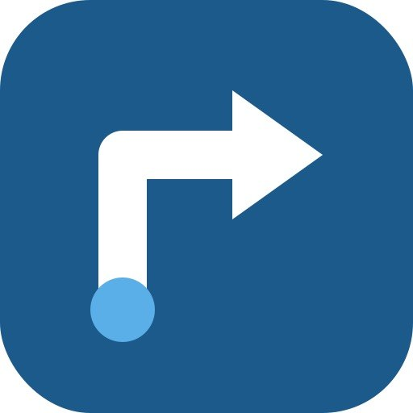
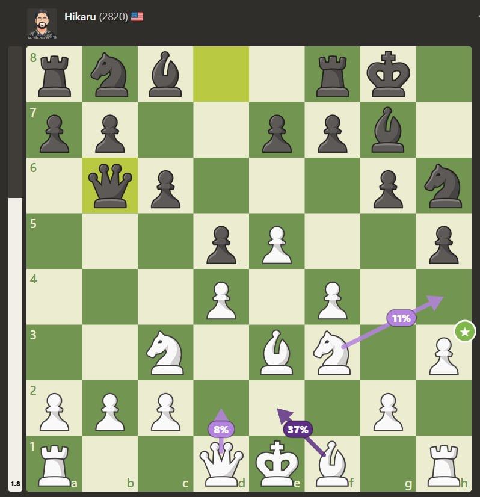
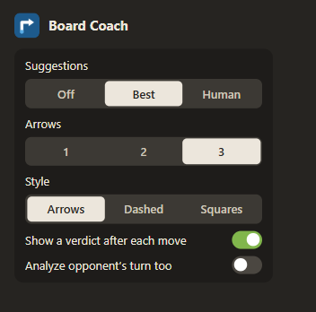
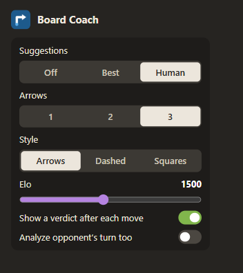

  

# Board Coach

A Chrome extension for Chess.com and Lichess that reviews your games with Stockfish 19 and shows the results
right on the board, entirely in your browser with no external servers. The review works on all your games,
against people or against the computer: as soon as a game ends the analysis starts on its own, and you can
reopen any finished game to go through it again.

## Installation
1. Unzip the archive into a folder.
2. Open `chrome://extensions` and turn on **Developer mode** (top right).
3. Click **Load unpacked** and select the unzipped folder.
4. Reload any Chess.com or Lichess tabs that are already open.

## Usage
The review works on every game you play, no matter who you played against. Everything happens inside the
Chess.com screen, with no separate windows:
- When a game ends, the analysis starts automatically and appears in the right sidebar, above the Chess.com move list.
- Mistakes (?!, ?, ??) are marked directly in the Chess.com move list.
- The board shows the move's mark, a green arrow for the best move, and an evaluation bar.
- Step through moves as usual (arrow keys or clicking moves in Chess.com's list).
- Settings open from the extension icon in the Chrome toolbar.

## Practice against the computer
On top of the review, there is a practice mode for games against the computer (Chess.com bots at
`chess.com/play/computer`, or the Lichess computer). Here the suggestions appear on the board while you
play: arrows with the moves before you play them (the best one is the darker arrow; human moves show how
likely each one is), a mark on each move after you play it, the evaluation bar, and ?!, ?, ?? in the move list.
This is a training aid, so it is limited to games against the computer. In games against people the extension
stays quiet until the game is over and only reviews it afterwards.

  

In Human mode each arrow is labelled with how likely that move is, and the bar on the left shows the evaluation.

Scores are in pawns from the point of view of the side to move (+1.0 = one pawn up). In the analysis at the end of the game, when there is a forced mate
the score is replaced by "Mate in 2" (you can force checkmate in 2 moves) or "Mated in 3" (that move lets the
opponent force checkmate in 3). The narrow evaluation bar shortens it to "M2".

## Settings
Click the extension icon in the Chrome toolbar. Changes apply right away. These control the practice mode
against the computer:

  
  &nbsp;&nbsp;
  

- **Suggestions**: Off (nothing during the game), Best (arrows for the engine's best moves) or Human
  (the moves a player of the chosen Elo would most likely play, with how likely each one is).
- **Arrows**: how many moves to show, 1 to 3. The darker arrow is the best / most likely one.
- **Style**: how suggestions are drawn: solid arrows, dashed arrows, or highlighted squares numbered 1 to 3.
- **Elo** (Human only): the level of the player to imitate. This is an estimate, not recorded human data. Low levels
  choose by simple habits (captures, checks, the centre, developing pieces), often miss that a piece can be taken,
  and make plenty of blunders; high levels follow the engine's shallow search closely.
  The level also adapts to the score by itself: when you are ahead the imitated player makes more mistakes, when you
  are behind fewer (up to 300 Elo up or down), which keeps the game close.
- **Show a verdict after each move**: the mark (★, ✓, ?!, ?, ??) on the board and in the move list after each move.
- **Analyze opponent's turn too**: suggestions for the computer's moves as well, and a mark on each move it plays.

The analysis at the end of a game, and of any finished game you open, always starts automatically.

## Lichess
Board Coach works on Lichess game pages too. A Lichess game counts as a game against the computer only when
Lichess itself reports the opponent as its AI; otherwise it is treated as a game against a person. The analysis
panel floats over the page (it can be dragged) because the Lichess sidebar has no room for it.

## Fair play
The extension refuses to analyze games in progress: it checks that the game is finished before running
the engine, and it never draws anything on positions that aren't part of the analyzed game.

## Notes
- Chess.com occasionally changes its page structure. If something stops working, the places to update are
  `findBoard`, `readPlacement`, `gameOverVisible`, `moveNodes` and `findSidebarAnchor` in `content/content.js`.
- Analyses are cached locally (last 30 games), so reopening a game is instant.

Licenses: Stockfish (GPLv3, `engine/COPYING.txt`), chess.js (BSD-2, `lib/LICENSE-chess.js.txt`).
